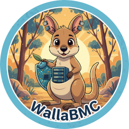
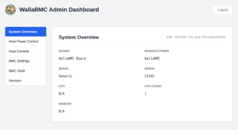

# WallaBMC

## Overview

WallaBMC is a simple, lightweight Baseboard Management Controller (BMC) firmware suitable for STM32 and similar class microcontrollers. Built on the Zephyr RTOS, WallaBMC provides essential BMC functionality including network management, host power control, and web-based administration through a Redfish-compliant interface.

WallaBMC is designed for embedded systems requiring BMC capabilities without the complexity of full-featured BMC solutions. It provides core functionality for monitoring and managing host systems through industry-standard interfaces.

### Features

* **LED Status Indicators**: Visual feedback for system status
* **IPv4 Networking**: Static IP or DHCP with mDNS hostname resolution
* **Redfish Interface**: Industry-standard RESTful API for management
* **Web Interface**: HTTP/HTTPS web UI for administration
* **BMC Console**: Management console accessible via serial or web interface
* **Persistent Configuration**: Settings stored across reboots
* **Host Power Control**: Power on/off management for host systems
* **Host Console**: Serial console access

### Hardware Support

WallaBMC currently supports the following hardware platforms:

| Hardware | Zephyr board name | Description |
| --- | --- | --- |
| **SiFive HiFive Premier P550 MCU** | hifive_premier_p550_mcu | RISC-V based platform |
| **STM32 Nucleo F767ZI** | nucleo_f767zi | ARM Cortex-M7 development board (standalone, no host CPU) |
| **Seeed Studio XIAO ESP32-C6** | xiao_esp32c6/esp32c6/hpcore | RISC-V, Wi-Fi 6, on a 21×17.5 mm board with USB-C; BMC console over USB Serial/JTAG (see [below](#seeed-xiao-esp32-c6)) |
| **WIZnet W5500-EVB-Pico2** | w5500_evb_pico2/rp2350a/m33 | Raspberry Pi RP2350A with built-in W5500 Ethernet; BMC console over USB CDC ACM (see [below](#wiznet-w5500-evb-pico2)) |
| **qemu** | qemu_cortex_m3 |see [run_qemu_ci.py](scripts/run_qemu_ci.py) |

### Screenshot

The main page of the web interface is shown below, click to enlarge.

[](img/web-ui.png)

XXX: put this in boards readme
### WIZnet W5500-EVB-Pico2

The W5500-EVB-Pico2 is a Raspberry Pi Pico 2 class board with a
RP2350A Cortex-M33 application core, an integrated W5500 Ethernet
controller connected over SPI, and a USB-C connector.  The BMC console
appears as a USB CDC ACM serial device, and the onboard W5500 provides
10/100 Ethernet with no extra wiring.

> **Board variant.** Use the Cortex-M33 target, not the Hazard3 target:
> `w5500_evb_pico2/rp2350a/m33`.

#### Wiring

The default overlay exposes the following signals on the Pico2 GPIO
headers:

| Pico2 pin | GPIO | Direction | Host signal | Notes |
| --- | --- | --- | --- | --- |
| GP6 | 6 | out | host UART RX | UART1 TX — host serial console (115200 8N1) |
| GP7 | 7 | in | host UART TX | UART1 RX — host serial console |
| GP2 | 2 | out (open-drain) | host power switch | Active-low 200 ms pulse on `power on/off` |
| GP3 | 3 | out (open-drain) | host reset input | Active-low 1 s low pulse on `reset` / `power force-restart` |
| GND | — | — | GND | Common reference, required |

> **Voltage warning.** RP2350 GPIOs are **not** 5 V tolerant.  If the
> host pulls any of these signals above 3.3 V, level-shift or buffer
> them appropriately.

#### Build and flash

The Pico2 uses the native UF2 bootloader rather than MCUboot, so the
build skips ``--sysbuild`` and must pass the board conf/overlay
explicitly:

```
cd zephyr
west build -b w5500_evb_pico2/rp2350a/m33 ../wallabmc --pristine \
    -- -DCONFIG_DEFAULT_ADMIN_PASSWORD='"admin"'
```

The build produces `build/zephyr/zephyr.uf2`.  To flash it:

1. Hold **BOOTSEL** on the Pico2 and tap **RUN** (or plug the board
   in while holding BOOTSEL).
2. Copy `build/zephyr/zephyr.uf2` to the `RPI-RP2` USB drive.

The USB-C port is used for both UF2 flashing and the BMC USB-CDC
console.  After the board boots, look for a new `/dev/ttyACM0` device.

#### Network

The W5500 Ethernet controller is enabled by the board's devicetree and
Kconfig defaults.  On boot WallaBMC requests a DHCPv4 lease and prints
the address on the BMC console.  Browse to `http://<ip>/` for the web
UI; the BMC shell is available on `/dev/ttyACM0` and (once the board
is on the network) through the web UI.

#### Known limitations

* The host serial bridge is compiled in and exposed through the web
  terminal and TCP port 22, but it has not yet been runtime-tested on
  this board.
* HTTPS is disabled in the current board configuration to reduce heap
  pressure; the web UI and Redfish run over plain HTTP.
* The USB device stack may log `usbd_ch9: protocol error` / `80 06 00
  06 00 00 0a 00` lines while the host enumerates.  This is harmless
  noise from unsupported Device Qualifier Descriptor requests.

#### Host control from the shell

```
power on              # 200 ms pulse on GPIO2 (if BMC believes host is off)
power off             # 200 ms pulse on GPIO2 (if BMC believes host is on)
power force-off       # 6 s pulse on GPIO2
power force-restart   # 1 s low pulse on GPIO3
reset                 # alias for power force-restart
```

## Using

### Prerequisites

Before getting started, ensure you have a proper Zephyr development environment. Follow the official [Zephyr Getting Started Guide](https://docs.zephyrproject.org/latest/develop/getting_started/index.html).

Required tools:

* West (Zephyr's meta-tool)
* CMake (version 3.20.0 or later)
* Python 3
* A toolchain for your target platform (ARM or RISC-V)
* OpenOCD or appropriate flashing tool for your hardware

### Installation

#### Initialize Workspace

The first step is to initialize the workspace folder where WallaBMC and all Zephyr modules will be cloned:

```
# Initialize workspace for WallaBMC (main branch)
west init -m https://github.com/tenstorrent/wallabmc.git --mr main workspace
# update Zephyr modules
cd workspace
west update
```

### Configuring

WallaBMC and Zephyr have some configuration options. Defaults generally should be used,
though there are some particular options for interest.

`CONFIG_DEFAULT_ADMIN_PASSWORD` - By default a random default admin password is generated
by the build. This can be overidden.

`CONFIG_DEFAULT_WIFI_SSID` - If the board supports WIFI, provide a default SSID. This can
be overidden by runtime configuration.

`CONFIG_DEFAULT_WIFI_PASSWORD` - If the board supports WIFI, provide a default passowrd.
This can be overidden by runtime configuration.

### Building

Append config options to the end of the build string
as such:

    `-- -DCONFIG_DEFAULT_ADMIN_PASSWORD='"admin"'`

Or run west `build -b <board> -t menuconfig` to change
these options.

### Building

Different boards have different build steps. Refer to the
board specific documentation for details.

[Nucleo F767ZI](boards/nucleo_f767zi.md)
[P550 MCU](boards/hifive_premier_p550_mcu.md)
[XIAO ESP32-C6](boards/xiao_esp32c6_hpcore.md)
[QEMU](boards/qemu_cortex_m3.md)

## Running

Each board has different features and capabilities, full details in
the board specific documentation. In general though, boards tend to:

* Be either standalone, that must have pins connected to a target to monitor
  and interact with it as a BMC. Or they are integrated MCU controllers on a
  system board that includes main CPUs, in the case of the P550 MCU.

* Have a status LED, which blinks slowly to indicate WallaBMC is running.

* Have a UART and power/reset control GPIOs.

* Have some networking link, either ethernet or Wi-Fi. WallaBMC by default uses
  DHCP with the hostname ``wallabmc`` to get an IP address lease.

* Support HTTP (and some HTTPS), and provide Redfish and a Web UI which can
  control the BMC and host system.

* Support an MCU serial console, JTAG, and flashing interface over a USB
  connection.  See board specific documentation for details about how to use
  JTAG, console, flash, etc.
  
### BMC shell

Most MCUs provide serial consoles via USB serial and via the Web UI. The Zephyr
application shell and logging is connected to this console. The shell includes
wallabmc commands.

The websocket BMC shell endpoint URL is /console/bmc and supports ws and
wss if ``CONFIG_APP_HTTPS`` (e.g., ``wss://wallabmc.local.net/console/bmc``).

### Host serial console

The websocket host console endpoint URL is /console/host and supports ws and
wss if ``CONFIG_APP_HTTPS`` (e.g., ``wss://wallabmc.local.net/console/host``).

### BMC shell settings and configuration

* ``help`` command listing with hierarchical help (e.g., ``help config``).
* ``config`` shell command can be used to configure the BMC.
* ``power`` can power the host on and off. On the Nucleo board there is no
  host CPU so one of the LEDs is a stand-in for a host power GPIO.

## Contributing

See [CONTRIBUTING.md](CONTRIBUTING.md) for information on how to contribute to this project.

## License

This project is licensed under the terms described in:

* [LICENSE](LICENSE) – code license
* [LICENSE_understanding.txt](LICENSE_understanding.txt) – license summary and clarification
* [LICENSE-DOCS](LICENSE-DOCS) – Creative Commons license for all documentation and logos
